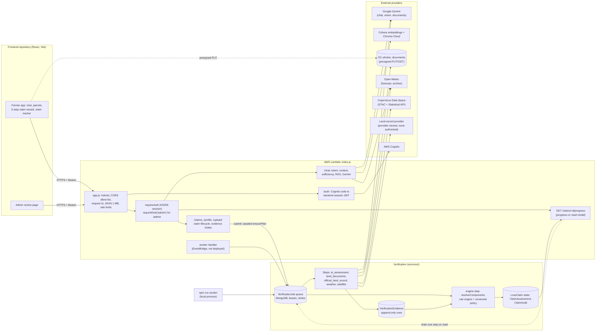

# Vivasayi AI (backend)

**A Node.js/Express backend for Tamil Nadu farmers. It combines a bilingual (Tamil and English), profile-aware advisory chat with a crop-loss claim pipeline. In that pipeline, models and providers only produce evidence; a deterministic, versioned rule engine makes every decision.**

Vivasayi AI began as a retrieval-augmented agriculture chatbot. It now has two products that share one account, one farm profile and one set of registered field polygons:

1. **Advisory chat.** For each message it works out what the farmer is asking about. It loads only the context that question needs (profile, a selected parcel, recent claims, weather, retrieved knowledge) and labels where each item came from. It asks a follow-up question only when something it genuinely needs is still missing.
2. **Crop-loss claims.** A farmer files a claim for a drawn area inside a registered parcel and attaches crop photos and land documents. A durable job queue in MongoDB then runs the evidence checks:
   - an AI photo assessment;
   - land-document reading;
   - an official land-record lookup;
   - historical weather;
   - Sentinel-2 vegetation change.

   Each check becomes an explicit per-component outcome, and a pure rule engine applies a versioned policy to reach a decision. A language model never decides a claim, and a technical failure never becomes a rejection.

The frontend (React, TypeScript, Vite, Playwright) lives in a separate repository, [`KishoreBalajiP/VivasayiAI-Frontend`](https://github.com/KishoreBalajiP/VivasayiAI-Frontend). The product vision is "a decision platform, not a chatbot" ([PRODUCT_PRINCIPLES.md](docs/product/PRODUCT_PRINCIPLES.md)).

> **Status (checked 2026-10-22 at `main` `14d92e2`).** The October 2026 work is merged to `main` (PR #8, 2026-10-17). The automated test suite passes, and the system has run end to end against mocked providers. It has **not** been validated on real claims, real farmers or real land documents. No authorised Tamil Nadu land-record API is available, and the live Gemini evaluations are blocked. CI's deploy job runs on every push to `main`. **I could not check from this machine whether that deploy ran.** The scheduled verification worker is **not** deployed by CI under any circumstances (see [Operations](#operations-deployment-and-observability)). Do not use this system to make real compensation decisions.

**Engineering goal.** Make crop-loss claim decisions explainable, auditable and robust to provider failure. Each evidence source has its own explicit outcome. One deterministic engine and a versioned, hashed policy decide. A missing or failing provider never produces an adverse outcome. A [research track](#research-question-and-methodology) evaluates whether that design holds up, mostly on synthetic data so far.

**Start here:** [docs hub](docs/README.md) · [claim flow](docs/architecture/CLAIM_FLOW.md) · [API reference](docs/architecture/08_API_Documentation.md) · [decisions (ADRs)](docs/decisions/18_DECISIONS.md) · [acceptance matrix](docs/engineering/ACCEPTANCE_MATRIX_2026-10-17.md) · [known issues](docs/engineering/KNOWN_ISSUES.md) · [evaluation](docs/research/evaluation/README.md)

---

## Why build it?

**The problem.** In crop insurance and relief schemes, someone has to decide whether a farmer's loss claim is credible. The evidence is scattered and of uneven quality:

- photographs taken on a phone;
- a scanned land record, which may be in Tamil;
- a field boundary drawn on a map;
- weather data for the district;
- satellite imagery, which may be cloudy for weeks during the monsoon.

No single source settles both who may claim and whether a loss happened. Each source also fails in its own way: a model misreads a photo, the satellite has no clear pass, the land-record service is down.

**Why the simpler approaches fall short.**

| Alternative | Why it is not enough |
|---|---|
| A large language model reads everything and decides | Hallucination risk. The decision cannot be reproduced. An outage or a malformed answer turns directly into a rejection. Nobody can explain afterwards which rule applied. |
| Photo-only review | Cannot see ownership problems, or a second farmer claiming the same land. In the synthetic fusion benchmark the photo-only policy approved 10 of 190 claims that the design rules forbid ([below](#metrics-and-interpretation)). |
| Satellite NDVI as an automatic trigger | Cloud cover, flooded paddy and normal harvest all move the vegetation index. In the live study a harvest produced a false "supports loss" ([below](#live-feasibility-study)). |
| A generic chatbot for advice | Asks farmers for details it already has, such as crop and district, and silently guesses when a farmer has several crops. |

**The design response.**

- **Evidence is separated from the decision.** Each component (photos, claimant rights, land documents, geometry, crop, satellite, weather, overlap, manual review) gets one of seven explicit outcomes. "Provider unavailable", "no evidence" and "contradicting evidence" are kept distinct.
- **One rule engine decides.** It is pure and deterministic, and every decision records the policy id and hash plus references to the evidence rows it used.
- **Uncertainty goes to a person.** When the AI alone says "no damage", or a check keeps failing, the claim is held for a reviewer instead of being rejected.
- **The chat is profile-aware.** It reuses what the farmer has already told the system.

**Intended users.** Smallholder farmers in Tamil Nadu (Tamil-first UI); reviewers or administrators who resolve held claims, overrides and appeals; and researchers studying evidence-gated verification.

**Deliberately out of scope:**

- fraud detection (overlap and name mismatches are review signals, never verdicts);
- proof of ownership (AI document reading is advisory only);
- proving the cause of a loss from NDVI;
- payment;
- notifications.

---

## System architecture



**Key design decisions** (ADR numbers refer to [docs/decisions/18_DECISIONS.md](docs/decisions/18_DECISIONS.md)):

- **Lambda freezes after the response, so slow work goes through a durable queue (ADR-021, ADR-022).** Submit writes the claim's job plan *before* answering. The jobs are then run by any of:
  - the scheduled worker;
  - the local `npm run worker` process;
  - a status read, which drains at most one step;
  - `POST /claims/:id/verify`, kept for reviewers and older clients.

  A lease with a heartbeat and owner-checked writes means a frozen or crashed run cannot overwrite a newer one.
- **The MongoDB collections are the source of truth.** `LossClaim` holds the state machine. `VerificationEvidence` is append-only, and the newest row per component is current. `ClaimAssessment` holds the latest decision, components, policy and hold. `ClaimAudit` is append-only history. `VerificationJob` holds queue state. The farmer's progress view is computed from these on every read and never stored.
- **No new claim states.** The ten claim states are frozen (ADR-019). "Held" is not a state: a held claim stays `submitted`, with a `hold` on its assessment.
- **Trust boundaries:**
  - The client never sends area, state, identity or a decision. The server recomputes area from the polygon and takes identity from the verified token.
  - Every resource is scoped by the caller's Cognito `sub`, and another farmer's resource returns 404.
  - The admin role comes from the Cognito groups claim, written into the backend's own session token at login.
  - Retrieved knowledge and document text are passed to the model as untrusted data inside a fenced block.
  - Model output is evidence, never a decision.

### Main data flows

**A. Advisory chat (`POST /chat`)**

1. `requireAuth` resolves the farmer. The rate limits are 30 per minute and 300 per day by default (`config/env.js`).
2. `services/context.service.js` classifies the intent ([`src/ai/Intent.js`](src/ai/Intent.js): greeting, claim status, crop recommendation, disease diagnosis, irrigation, fertilizer, weather planning, general, unclear). It then loads only the sources that intent needs from the caller's own records.
3. Each context item is tagged `verified`, `user_provided`, `third_party`, `inferred`, `missing` or `stale`.
4. [`src/ai/ContextSufficiency.js`](src/ai/ContextSufficiency.js) checks the intent's required slots (for example crop and district) once retrieval is done. If one is still unresolved, the prompt instructs the model to ask **one** targeted question.
5. For knowledge intents, `performRAG` in [`services/chat.service.js`](services/chat.service.js) embeds the message with Cohere `embed-english-v3.0` and queries the Chroma collection (top-3 by default). The chunks go into the prompt fenced as data, and the response returns the source file names.
6. Gemini (`gemini-2.5-flash` by default) answers in the requested language, else the message's script, else the profile language.
7. The turn is saved in the caller's `ChatSession`.

If Gemini refuses the call for quota or overload, the client gets 503 "AI service is busy", not a timeout or a 500.

**B. Claim submission and automatic verification**

1. **Draft.** The wizard creates a draft with `POST /claims`, which is idempotent through a client `idempotencyKey`. The server computes the claimed area from the drawn polygon and checks that it lies inside the farmer's registered parcel.
2. **Evidence.** Photos go through `POST /claims/:id/evidence/presign`, then a browser PUT to S3, then `.../complete`. The server re-validates the stored object. Land documents use `/upload/presign`, then `POST /claims/:id/ownership` with a document category.
3. **Submit** (`POST /claims/:id/submit`) does a compare-and-set from `draft` to `submitted`, sets `firstSubmittedAt` and `submissionRound`, then **awaits** `ensurePlan`. That writes one job per applicable step for this round: `ai_assessment` if photos exist; `land_documents` and `official_land_record` if documents exist; `weather` and `satellite`; then `engine`. A unique partial index on `{claimId, step, planKey}` stops a retried or concurrent submit from duplicating jobs. If the plan cannot be written, the claim stays submitted and the response is 503 "saved, checks not scheduled". A repeated submit, or the worker's reconcile sweep, recovers it.
4. **Steps.** A runner claims the next due job under a 60 s lease ([`services/verificationJobs.service.js`](services/verificationJobs.service.js)) and runs it ([`services/verificationSteps.js`](services/verificationSteps.js)). The outcome is written as an append-only `VerificationEvidence` row.
5. **Engine.** The `engine` job waits only for the steps the policy lists in `engineWaitsFor`. Satellite never blocks it. The engine then:
   - computes the component outcomes ([`services/verificationComponents.js`](services/verificationComponents.js));
   - runs the frozen rules and the policy ([`services/claimVerificationEngine.service.js`](services/claimVerificationEngine.service.js));
   - writes the decision, or a hold, with the policy id and hash and the evidence references ([`services/claimVerification.service.js`](services/claimVerification.service.js)).
6. **Late evidence.** A photo or document added after submit queues new jobs keyed by the evidence version. Resubmitting from `more_evidence_required` starts a new round.

**C. Farmer status (`GET /claims/:id/progress`)**

1. Ownership is checked first. Then, unless disabled, the read drains at most one due step within a 20 s budget.
2. [`services/claimProgress.js`](services/claimProgress.js) builds the `progress-v1` view from persisted state only:
   - the overall status;
   - six stages, each with a status, real timestamps and an explanation key;
   - required actions;
   - a satellite display status;
   - `nextCheckAt`, which is set only from a real job `runAt`.
3. Job ids, error codes, review cases, NDVI values, provider names and the policy hash are never included ([PROGRESS_CONTRACT_v1.md](docs/architecture/PROGRESS_CONTRACT_v1.md)).

**D. Failure and recovery**

- **Provider errors** are classified ([`utils/providerErrors.js`](utils/providerErrors.js)) as quota, overload, timeout, network, auth/config, malformed, storage or defect, and retried with jittered backoff: 1 min, 5 min, 15 min, 1 h, 1 h, 3 h.
- **Dead jobs.** A job that runs out of attempts opens a labelled review case. Satellite and weather jobs are the exception, since they are supporting evidence only.
- **Recovery sweeps** in [`services/verificationWorker.service.js`](services/verificationWorker.service.js):
  - re-queue jobs that died from transient errors, after 6 h, for at most 2 rounds;
  - release claims stuck in `processing`;
  - reconcile submitted claims that have no plan;
  - escalate stale holds where the policy sets a limit.
- **Withdrawal** cancels queued jobs, so a withdrawn claim makes no further model calls and opens no review cases.

---

## Research question and methodology

The research question, worked through in [docs/research/](docs/research/): **does reducing every evidence source to an explicit component outcome, and letting only a deterministic versioned policy decide, prevent invalid approvals and adverse decisions caused by provider failure, compared with photograph-only review?** A second question asks whether profile-aware context reduces unnecessary follow-up questions in the advisory chat.

The seven pre-registered questions RQ1–RQ7 are in [research_questions.md](docs/research/research_questions.md); the literature review is in [literature_review.md](docs/research/literature_review.md).

Status of each question:

- **Tested:** RQ5 (behaviour when providers fail) and RQ6 (deterministic, auditable decisions), through the test suites.
- **Tested on synthetic data only:** RQ1 (follow-up questions) and RQ3 (evidence fusion).
- **Pending:** RQ2 (answer quality), RQ4 (satellite) and RQ7 (document reading). They need a billed Gemini key, expert raters, independently labelled events or labelled documents.

The table in `research_questions.md` still lists RQ4 as needing Copernicus credentials. The live satellite case studies described below have since run, but they are not labelled data, so RQ4 is still unanswered.

---

## How to read the results

There are four kinds of evidence. They are kept apart on purpose, and each establishes something different:

| Kind | What it establishes | What it does **not** establish |
|---|---|---|
| Automated tests (unit, integration, Playwright e2e) | The code behaves as specified. They run against an in-memory or loopback MongoDB with **mocked or fake providers**. | That live providers work, or that decisions are accurate |
| Synthetic benchmarks (`npm run eval`) | The components follow their own rules, against analytic or design-rule ground truth | Accuracy on real claims |
| Live feasibility runs (16 Oct 2026) | The production adapters work against real providers on a handful of cases | Damage-detection accuracy (no labels) |
| Real-world validation | — | **Not done.** No real claims, farmers, annotators or authorised records |

### Snapshots

| Snapshot | Date | Code | What ran | Reproducible? |
|---|---|---|---|---|
| Synthetic benchmarks | 2026-10-16 | `522d212` plus uncommitted changes (committed later that day as `b760596` / `6dbe6b8`); Node v26.7.0 | Geometry, fusion, chat follow-ups, name matching, satellite simulation ([SUMMARY.md](docs/research/evaluation/results/SUMMARY.md)) | Yes, deterministic and seeded (`npm run eval`) |
| Fusion row for `v1.1-safe-ai` | 2026-10-16 | `6dbe6b8` plus uncommitted changes | The same 192 scenarios under the new default policy ([fusion_v1.1_2026-10-16.json](docs/research/evaluation/results/fusion_v1.1_2026-10-16.json)) | Yes; the command checks that the published rows still reproduce byte for byte |
| Live feasibility | 2026-10-16 | `b760596` / `6dbe6b8` working tree | Provider check, 12 Sentinel-2 runs, 22 retrieval queries, local farmer journeys ([LIVE_RESULTS](docs/research/evaluation/live/LIVE_RESULTS_2026-10-16.md)) | Only partly: live services drift, and raw provider responses were not saved. Hashes of the result files are pinned in `FROZEN_HASHES.json`. |
| Acceptance and independent audit | 2026-10-17 | `6dbe6b8`, frontend `56f26eb`, both plus their working trees (since merged) | All suites in both repos, 3 independent audits, 16-mutant mutation test ([ACCEPTANCE_MATRIX](docs/engineering/ACCEPTANCE_MATRIX_2026-10-17.md)) | The raw reports were in `test-results/`, which is gitignored and no longer on this machine. The matrix summarises them. |
| This README | 2026-10-22 | `main` `14d92e2` (clean tree) | Backend suite, engine golden replay, manuscript number check, hermetic harness boot and one claim journey (see [Reproducing](#reproducing-experiments-and-tests)) | Yes. The frontend repo was not on this machine and was not re-checked. |

### Evaluation datasets and workloads

| Evaluation | Purpose | Data | Size | Kind |
|---|---|---|---|---|
| Geometry ([geometry.json](docs/research/evaluation/results/geometry.json)) | Containment, cross-farmer overlap flag, invalid geometry, area | Generated polygons on Tamil Nadu coordinates, with analytic ground truth | 300 containment cases, 300 overlap cases, 100 valid polygons for false rejection | Synthetic |
| Evidence fusion ([fusion.json](docs/research/evaluation/results/fusion.json)) | Do the policies approve what the design rules forbid? | A factorial of claim factors (photos, rights, overlap, geometry…) | 192 scenarios (190 should not be approved, 2 are approvable); 1,536 satellite/weather comparisons per policy | Synthetic; the label is the design rule |
| Chat follow-ups ([chatContext.json](docs/research/evaluation/results/chatContext.json)) | Unnecessary or missed follow-ups, intent classification | Author-written specification cases | 55 cases (44 need no follow-up, 11 need one); 29 for intent | Author-labelled |
| Name matching ([names.json](docs/research/evaluation/results/names.json)) | Tamil/Latin holder-name matcher | Author-labelled name pairs | 60 pairs | Author-labelled; the matcher was tuned on this same set |
| Satellite simulation ([satelliteSimulation.json](docs/research/evaluation/results/satelliteSimulation.json)) | Behaviour of the NDVI-change rule under noise and masking | Simulated NDVI series | 400 trials per setting | Simulated, no imagery |
| Live Sentinel-2 ([satellite_case_studies_2026-10-16.json](docs/research/evaluation/live/satellite_case_studies_2026-10-16.json)) | Does the production adapter work on real imagery? | 100 m squares near 3 documented events (south Tamil Nadu floods Dec 2023, Cyclone Michaung Dec 2023, Cyclone Fengal Nov–Dec 2024, located from Sphere India situation reports), plus a Thanjavur harvest control | 12 squares (9 event, 3 control) | Real imagery, **no damage labels** |
| Live retrieval ([rag_retrieval_2026-10-16.json](docs/research/evaluation/live/rag_retrieval_2026-10-16.json)) | Does production retrieval return answer-bearing chunks? | The production Chroma collection (450 chunks from 60 files) | 22 queries (13 answerable from the corpus, 9 advisory) | Real corpus; relevance judged by an author-written rule fixed before the run |
| Farmer journeys ([acceptance_v1-legacy](docs/research/evaluation/live/acceptance_v1-legacy_2026-10-16.json), [v2](docs/research/evaluation/live/acceptance_v2-components_2026-10-16.json)) | Does the HTTP journey work end to end? | The real app over HTTP, local database, mock image AI and land records | 26 / 27 steps | Scripted |

### Metrics and interpretation

**Evidence fusion and ablation (192 synthetic scenarios).** "Invalid approvals" counts approvals of scenarios that the design rules say must not be approved. Because the label *is* the rule the gate implements, this measures **rule enforcement, not accuracy**.

| Policy | Main difference | Invalid approvals | Rejected on AI reading alone | Held for review |
|---|---|---:|---:|---:|
| `v1-legacy` (photo-only) | Historical rules; components recorded but never block | 10 / 190 | 2 / 2 | 0 |
| **`v1.1-safe-ai` (current default)** | v1-legacy, except that AI-only "no damage" and technical failures hold | **10 / 190** (95% CI 2.9–9.4%) | **0 / 2** | 12 |
| `v2-components` (full gate) | Requires parcel identity, geometry, photos, overlap and claimant rights | 0 / 190 | 0 / 2 | 40 |
| v2 without claimant rights | Ablation | 4 / 190 | 0 / 2 | 42 |
| v2 without overlap | Ablation | 2 / 190 | 0 / 2 | 38 |
| v2 without photos | Ablation | 0 / 190 | 0 / 2 | 40 |
| v2 without geometry | Ablation | 0 / 190 | 0 / 2 | 40 |

Reading:

- The gate's own contribution comes from **claimant rights and cross-farmer overlap**. Removing the photo or geometry requirement changes nothing, because the frozen engine rules already enforce both.
- Satellite and weather changed **0 of 1,536** outcomes under every policy, by design.
- **Negative result:** the default `v1.1-safe-ai` does **not** reduce invalid approvals. It only removes adverse decisions made on the AI reading alone. The only policy that reduces invalid approvals, `v2-components`, is not the default: no authoritative claimant-rights source exists, so in practice almost every claim would wait for manual review.
- The 2-scenario denominators are tiny.

**Geometry** ([SUMMARY.md](docs/research/evaluation/results/SUMMARY.md)):

| Metric | Result |
|---|---|
| Containment and outside-parcel detection | Precision 1, recall 1 (n=300) |
| Cross-farmer overlap review flag | Precision 1, recall 1 (n=300) |
| Invalid geometry | Recall 1; 0 of 100 valid polygons wrongly rejected |
| Area | Server acres exceed an ellipsoidal reference by a **median 0.63%**, systematically, because the formula uses a sphere with the WGS84 equatorial radius ([`services/parcelGeometry.service.js`](services/parcelGeometry.service.js)). Not changed, because stored areas would stop being comparable. Needs a product decision. |

These scores show that the code matches exact geometry. They say nothing about real cadastral boundaries.

**Chat follow-up decisions** (55 specification cases):

| Metric | Previous rule ("ends with ?") | Current logic |
|---|---:|---:|
| Unnecessary follow-ups | 36 / 44 (81.8%) | 0 / 44 |
| Necessary follow-ups missed | 3 / 11 | 0 / 11 |
| Crop silently assumed when the farmer has several | 6 / 6 | 0 / 6 |
| Intent classification | — | 29 / 29 |
| Context assembly latency p50 / p95 | — | 0.37 / 0.75 ms (weather stubbed) |

The specification and the new logic share an author, and the baseline is a reimplementation of the old heuristic. Treat this as a conformance check, not a user study.

**Name matching:** 60 / 60. This is **optimistic**: it was 55 / 60 before a rule change made after seeing those errors on the same set. A held-out set is needed.

**Satellite rule, simulated** (400 trials each):

| Setting | Result |
|---|---|
| No change, clear or cloudy sky | 0 false "supports loss" |
| NDVI drop of 0.15, clear sky | detected 199 / 400 times |
| NDVI drop of 0.30, clear sky | detected 399 / 400 times |
| 70% of post-event pixels masked | inconclusive 400 / 400 times |

The simulation does not model seasonal change, which the live study below shows matters.

#### Live feasibility study

**Sentinel-2, 12 live runs of the production adapter** (2026-10-16): median latency 2.5 s, maximum 11.8 s.

| Group | Supports loss | No change | Inconclusive |
|---|---:|---:|---:|
| 9 squares near documented flood/cyclone events | 0 | 5 | 4 |
| 3 squares, Thanjavur harvest control (Feb 2024) | **1 (false)** | 1 | 1 |

- Of the 4 inconclusive event squares, 3 had no valid post-event statistics and 1 had too few valid post-event pixels.
- Several event fields were bare or flooded *before* the event, so a fixed window could not show a loss.
- The harvest control's "supports loss" (ΔNDVI −0.25, from 0.74 to 0.49) is normal phenology, not damage.
- **This is why satellite evidence is supporting-only and never decides or delays a claim.** Land cover, crop and actual damage at each square were not verified.

**Retrieval over the production knowledge base** (22 queries, top-3):

| Metric | Result |
|---|---:|
| Answerable questions with any relevant chunk | 2 / 13 |
| Top-1 relevant | 1 / 13 |
| Expected file retrieved at all | 10 / 13 |
| Expected-file hits that were header-only chunks (no data rows) | 9 / 11 |
| Advisory questions: answer-bearing chunks | 0 / 27 |

The corpus is district statistics tables plus a geography file; it has no advisory text. Ingestion also split each table into a header-only chunk and row chunks with no file or column context.

**Farmer journeys over HTTP** (real app, local database, mock image AI and land records): 24 / 26 steps passed under `v1-legacy` and 25 / 27 under `v2-components`. The only failures were the two live chat steps, blocked by the Gemini quota.

**Blocked.** The live chat comparison (46 items) and synthetic land-document extraction (12 rendered, watermarked documents, 3 with injected instructions) are implemented. They produced **no results**: the Gemini key was on a free tier and its quota ran out ([live_eval_status](docs/research/evaluation/live/live_eval_status_2026-10-16.json)).

**Not completed.** A live before/after evaluation of the RAG chunking fix was started on 2026-10-17 and stopped at the owner's request. Its parity check against the frozen baseline **failed**, so no "after" numbers exist ([STATUS_2026-10-17.md](docs/research/evaluation/live/rag/STATUS_2026-10-17.md)).

---

## Architecture and implementation layers

### Layer 1: Edge, identity and access control

**What it does:** It wraps the Express app for Lambda, applies security headers, a CORS allow-list and per-user rate limits, exchanges a Cognito authorization code for a backend session token, and scopes every request to the caller.

| Component | Responsibility | Implementation |
|---|---|---|
| Lambda entry | `handler` (HTTP via `serverless-http`) and `worker` (scheduled). Boot guards: required env, `assertProductionSafety()`, `assertPolicyConfigured()`. Listens on `PORT` (default 8000) outside Lambda | [`index.js`](index.js) |
| Express app | helmet, CORS, request logger with a validated correlation id, JSON 1 MB, public `/`, `/health`, `/auth`; everything else behind `requireAuth` | [`app.js`](app.js) |
| Login | `POST /auth/google {code}` exchanges the code with Cognito and verifies the id token. A legacy account is linked only when `email_verified` is true. Issues an HS256 access token (15 min default) carrying the role from Cognito groups | [`services/auth.service.js`](services/auth.service.js), [`utils/token.js`](utils/token.js) |
| Authorisation | `requireAuth` verifies the session token; `requireRole("admin")` guards `/admin` | [`middlewares/auth.js`](middlewares/auth.js), [`middlewares/authorize.js`](middlewares/authorize.js) |
| Rate limits | Per-user, in memory. Claim writes 15/h, evidence 60/h, claim reads 600/h (`RATE_LIMIT_DEFAULTS`). Chat 30/min and 300/day. Uploads 10/min | [`middlewares/rateLimit.js`](middlewares/rateLimit.js), [`config/env.js`](config/env.js) |
| CORS | Allow-list from `CORS_ORIGINS`; exposes `Retry-After`, `x-request-id`, `RateLimit-Reset` | [`middlewares/cors.js`](middlewares/cors.js) |

#### Problems discovered and how they were addressed

| Problem found | Evidence | Fix | Code / test | Measured impact |
|---|---|---|---|---|
| Login failures all returned 500, and the raw Axios error (containing the client secret and auth code) was logged | Code review, Phase A | 4xx kept as 4xx, outage as 502; logs sanitised | AU-1..AU-11 in [`tests/auth.service.test.js`](tests/auth.service.test.js) | Regression-tested |
| An unverified email could be linked to an existing account | Code review | Linking requires `email_verified` | AU-8 | Regression-tested |
| Another farmer's appeal status could be read (200 with data) | Authorisation sweep found it | Returns 404 for a foreign claim | AZ-1 in [`tests/authz.matrix.test.js`](tests/authz.matrix.test.js) | Every `/claims/:id/*` and `/admin/*` route now returns 404/403 to a foreign or non-admin caller, with no side effects (AZ-1..4) |
| 5/h claim writes and 20/h evidence calls blocked one normal 10-photo claim | Acceptance harness had to raise the limits to finish a journey | Defaults raised to 15/h and 60/h (owner decision D5) | RL-7, RL-8 in [`tests/claims.ratelimit.test.js`](tests/claims.ratelimit.test.js) | A 10-photo, 2-document claim fits the defaults (RL-8) |

### Layer 2: Farmer records, parcels and geometry

**What it does:** Stores the farm profile (district, crops, acres, language) and its registered parcels as polygons. It also validates geometry and computes area on the server.

| Component | Responsibility | Implementation |
|---|---|---|
| Profile and parcels | CRUD scoped by Cognito `sub`. Client-supplied area is ignored and the server computes it | [`services/farmProfile.service.js`](services/farmProfile.service.js), [`services/parcel.service.js`](services/parcel.service.js), [`models/FarmProfile.js`](models/FarmProfile.js) |
| Geometry | Closed ring, finite in-range coordinates, no self-intersection, non-zero area. Spherical area with R = 6,378,137 m | [`services/parcelGeometry.service.js`](services/parcelGeometry.service.js) |
| Claim spatial checks | Containment in the parcel (with tolerance), overlap with the farmer's own claims, remaining eligible area | [`services/claimSpatial.service.js`](services/claimSpatial.service.js) |
| Cross-farmer overlap | Bounding-box pre-filter plus exact intersection. A **review signal only**, because shared boundaries and joint holdings are legitimate causes | [`services/crossFarmerOverlap.service.js`](services/crossFarmerOverlap.service.js), [`utils/geometryBbox.js`](utils/geometryBbox.js) |
| Districts | Reference coordinates for weather and context | [`config/districts.js`](config/districts.js), [`scripts/seedDistricts.js`](scripts/seedDistricts.js) |

**Measurements:** see Geometry above. **Known gaps:** the systematic +0.63% area bias, and Tiruvarur missing from the district list (37 entries).

### Layer 3: Advisory chat and retrieval

**What it does:** Answers farming questions in Tamil or English, using the farmer's own records plus retrieved knowledge, and asks at most one follow-up when something essential is missing.

| Component | Responsibility | Implementation |
|---|---|---|
| Intent and context | Classifies intent and loads only the needed sources, tagged by provenance | [`services/context.service.js`](services/context.service.js), [`src/ai/Intent.js`](src/ai/Intent.js) |
| Sufficiency gate | Required slots per intent; one targeted follow-up | [`src/ai/ContextSufficiency.js`](src/ai/ContextSufficiency.js) |
| Prompting | Templates; retrieved text fenced as data with an instruction to ignore embedded instructions | [`src/ai/PromptBuilder.js`](src/ai/PromptBuilder.js), [`src/ai/PromptTemplates.js`](src/ai/PromptTemplates.js) |
| Model call and retrieval | Gemini via LangChain (25 s timeout, 1 retry by default); Cohere + Chroma retrieval with source attribution | [`services/chat.service.js`](services/chat.service.js), [`utils/aiTimeout.js`](utils/aiTimeout.js) |
| Image turns | Photo diagnosis through the same model | [`services/chatImage.service.js`](services/chatImage.service.js) |
| Weather | Open-Meteo forecast for the district's stored coordinates, with cache and staleness marking | [`services/weather.service.js`](services/weather.service.js) |
| Ingestion | S3 CSVs to chunks to embeddings. The `table-v1` chunker gives every chunk the file, table and column context plus at least one data row | [`rag/ingest.js`](rag/ingest.js), [`rag/ingestHelpers.js`](rag/ingestHelpers.js) |

There is **no soil data source**; the assistant recommends a soil test rather than guessing.

#### Problems discovered and how they were addressed

| Problem found | Evidence | Fix | Code / test | Measured impact |
|---|---|---|---|---|
| A follow-up was asked whenever a message ended in "?", and a crop was assumed silently when the farmer had several | Synthetic specification | Intent classification plus a sufficiency gate | [`tests/chat.context.test.js`](tests/chat.context.test.js), [`tests/chat.pipeline.test.js`](tests/chat.pipeline.test.js) | Unnecessary follow-ups 36/44 → 0/44 (synthetic) |
| A Gemini quota error was retried until the 25 s timeout and reached the farmer as a 500 "did not respond in time" | Live run, 16 Oct | Retries capped; quota/overload mapped to 503 "busy" | PL-11, PL-12 in [`tests/chat.pipeline.test.js`](tests/chat.pipeline.test.js) | Regression-tested |
| Retrieval returned header-only chunks, and row chunks lost their table context | Live retrieval study: 9 of 11 expected-file hits were header-only; 2/13 relevant | `table-v1` chunker; local index builder; frozen evaluation rule | RC-1..RC-16 in [`tests/rag.chunker.unit.test.js`](tests/rag.chunker.unit.test.js), RS-1..3 | **Unmeasured.** The before/after run was stopped and production still uses the old collection |
| The knowledge base has no advisory text | Live study: 0/27 answer-bearing advisory chunks | **Unresolved:** needs new content | — | — |

### Layer 4: Claim lifecycle and evidence intake

**What it does:** Runs the claim state machine, accepts photos and land documents through presigned storage, and creates the verification plan durably and idempotently.

| Component | Responsibility | Implementation |
|---|---|---|
| State machine | Ten frozen states: `draft → submitted → processing → verified / partially_verified / more_evidence_required / rejected / out_of_limit / duplicate_area`; `withdrawn` from draft or submitted. Resubmit only from `more_evidence_required` | [`services/claimState.service.js`](services/claimState.service.js), [`models/LossClaim.js`](models/LossClaim.js) |
| Claim service | Create (idempotent key), compare-and-set submit, resubmit and withdraw; `firstSubmittedAt`, `submissionRound` | [`services/claim.service.js`](services/claim.service.js) |
| Plan scheduling | Awaited `ensurePlan` with `planKey`, `requestId`, `correlationId`; late-evidence plans | [`services/claimVerificationPipeline.service.js`](services/claimVerificationPipeline.service.js), [`services/verificationJobs.service.js`](services/verificationJobs.service.js) |
| Photo evidence | Presign, direct S3 PUT, server re-validation, signed view URLs (max 10 images) | [`services/claimEvidence.service.js`](services/claimEvidence.service.js), [`services/s3.service.js`](services/s3.service.js) |
| Land documents | Generic upload, then attach with a category. The claimant relationship selects which categories are expected | [`services/ownershipEvidence.service.js`](services/ownershipEvidence.service.js), [`services/uploadPresign.service.js`](services/uploadPresign.service.js), [`config/claimantEvidence.js`](config/claimantEvidence.js) |

#### Problems discovered and how they were addressed

| Problem found | Evidence | Fix | Code / test | Measured impact |
|---|---|---|---|---|
| The job plan was enqueued fire-and-forget after the response, so on Lambda it could be lost, and resubmit or late evidence queued nothing | Code audit | Awaited, idempotent `ensurePlan`; late-evidence and resubmit plans | EQ-1..EQ-10 in [`tests/verificationEnqueue.test.js`](tests/verificationEnqueue.test.js) | 10 concurrent submits give one audit row and one job per step (EQ-2) |
| A repeated submit after the worker had already decided the claim was not idempotent | Found by browser test E2E-03 | Returns 200 with the decided claim and writes nothing | EQ-10 | Regression-tested |
| Withdrawal raced the engine, and jobs for withdrawn claims still called Gemini and opened review cases | Code audit | Compare-and-set withdraw; jobs cancelled | EQ-8, EQ-9, VJ-22 | Zero model calls and zero review cases after withdrawal (EQ-8) |

### Layer 5: Evidence providers

**What it does:** Turns each external source into an append-only evidence row with an explicit status. A provider failure becomes `unavailable`, never a negative finding.

| Step | Provider | Behaviour | Implementation |
|---|---|---|---|
| `ai_assessment` | Gemini vision on stored photos | Each image has its own budget (25 s) and progress is checkpointed after each one. Malformed output under v1.1 is a retryable failure, not "uncertain" | [`services/claimAssessment.service.js`](services/claimAssessment.service.js), [`services/claimVision.service.js`](services/claimVision.service.js) |
| `land_documents` | Gemini reading documents into structured fields | Advisory only. Tamil/Latin name matching. Document text treated as data. Retryable failures retry; documents already examined are skipped | [`services/landDocumentExamination.service.js`](services/landDocumentExamination.service.js) |
| `official_land_record` | Provider-neutral HTTP adapter (`LAND_RECORD_PROVIDER_URL`) | Runs after `land_documents`. Without an authorised provider it returns `unavailable`, never a match | [`services/officialLandRecord.service.js`](services/officialLandRecord.service.js) |
| `weather` | Open-Meteo archive around the event at the claim centroid | Supporting only; never rejects | [`services/weatherArchive.service.js`](services/weatherArchive.service.js) |
| `satellite` | Copernicus Data Space: STAC discovery plus the Statistical API (Sentinel-2 L2A) | Per-pixel NDVI mean over the claim polygon, masking SCL classes 0, 1, 3, 8, 9, 10 (water is kept). Pre window event −40 to −5 days, post window +1 to +20 days. Reschedules until the post window closes. **Authenticated processing is off by default** (`SATELLITE_PROCESSING_ENABLED=false`) | [`services/satelliteVerification.service.js`](services/satelliteVerification.service.js), [`services/satellite/`](services/satellite/) |

#### Problems discovered and how they were addressed

| Problem found | Evidence | Fix | Code / test | Measured impact |
|---|---|---|---|---|
| Every live NDVI analysis returned "no valid statistics": the response was read at the wrong nesting level | Live run, 16 Oct | Parser accepts the real body; a recorded live response is now a fixture | NS-13 in [`tests/ndviStatistics.unit.test.js`](tests/ndviStatistics.unit.test.js) | All 12 live runs then returned a result: 9 analysed, 3 with no valid post-event statistics |
| A 30% scene-level cloud filter rejected all monsoon imagery for small parcels | Live run | A separate 90% scene limit for parcel statistics; per-pixel masking does the rest. **A post-hoc change, disclosed in the manuscript**; thresholds unchanged | [`services/satellite/config.js`](services/satellite/config.js) | Analyses became possible; not calibrated |
| The original proof-of-concept request was rejected by the live service (HTTP 400, missing `dataMask` output) | Live resolution check | The production request is used instead | [`poc/satellite/`](poc/satellite/) | — |
| Satellite rows did not record the adapter outcome or per-window scenes | Research audit | `metadata.outcome` and `discovery.scenesByWindow` added; evidence fingerprints unchanged | PC-7 in [`tests/satelliteAdapter.unit.test.js`](tests/satelliteAdapter.unit.test.js) | — |
| `land_documents` reported success even when every document hit a quota error | Code audit | Retryable failures throw so the job retries | VJ-19 in [`tests/verificationJobs.test.js`](tests/verificationJobs.test.js) | Regression-tested |

### Layer 6: Verification job queue and worker

**What it does:** Runs the evidence steps and the engine reliably on Lambda, where the runtime freezes between requests.

| Component | Responsibility | Implementation |
|---|---|---|
| Job model | Steps `ai_assessment`, `land_documents`, `official_land_record`, `satellite`, `weather`, `engine`; statuses `queued`, `running`, `succeeded`, `failed`, `dead`, `cancelled`; per-step timestamps and an attempt log | [`models/VerificationJob.js`](models/VerificationJob.js) |
| Queue | Atomic claim-next with a 60 s lease plus heartbeat; owner-checked writes; jittered backoff; per-step attempts (7 for AI and documents, 5 otherwise); dependencies; `NON_BLOCKING_STEPS = [satellite]` | [`services/verificationJobs.service.js`](services/verificationJobs.service.js) |
| Worker | `drainDueJobs` plus recovery sweeps; `runWorkerLoop` with graceful shutdown; Lambda `handleScheduledWorker` | [`services/verificationWorker.service.js`](services/verificationWorker.service.js) |
| Worker CLI | `npm run worker` with `--once` and `--requeue-dead [--dry-run]`. Refuses any database that is not on this machine unless `WORKER_ALLOW_REMOTE_DB=true` | [`scripts/worker.js`](scripts/worker.js) |
| Scheduled deployment | CloudFormation: worker Lambda from the same image, EventBridge rule **DISABLED by default** | [`infra/verification-worker.yaml`](infra/verification-worker.yaml), [WORKER_RUNBOOK.md](docs/engineering/WORKER_RUNBOOK.md) |

#### Problems discovered and how they were addressed

| Problem found | Evidence | Fix | Code / test | Measured impact |
|---|---|---|---|---|
| The engine waited for satellite until event + 21 days, and the claim window was checked at decision time, so waiting could become a late-claim rejection | Code audit | Satellite non-blocking under **every** policy; the window is measured at first submission under v1.1 | VJ-20, VF-3/VF-4, SA-4, SA-5 | Regression-tested |
| No lease renewal and no owner check: a slow run could overwrite the run that took over its job | Code audit; audit C showed VJ-14 alone did not catch it | Heartbeat plus owner-checked writes; VJ-14c added | VJ-14, VJ-14c, VJ-15 in [`tests/verificationJobs.test.js`](tests/verificationJobs.test.js) | The mutation that removes the owner check is now caught |
| Automatic dead-job recovery stalled once 50 unrecoverable rows existed | Reviewer probe | Candidate query joins on submitted claims | VJ-23b | Regression-tested |
| A crashed worker could lose or duplicate work | Crash tests on a real child process | Lease expiry takes over; SIGTERM finishes the job in flight | WK-7, WK-8 in [`tests/worker.crashRecovery.test.js`](tests/worker.crashRecovery.test.js); browser test E2E-11 | One decision after SIGKILL and restart |

### Layer 7: Decision: components, policy and rule engine

**What it does:** Reduces the evidence rows to ten component outcomes, applies the frozen rules and the selected policy, and records the result with its policy hash.

| Component | Responsibility | Implementation |
|---|---|---|
| Component resolver | Ten components, each one of `verified`, `failed`, `unverified`, `unavailable`, `inconclusive`, `pending`, `requires_review`. Model-derived evidence is never authoritative. Review-case rows are excluded from satellite and weather | [`services/verificationComponents.js`](services/verificationComponents.js) |
| Policies | Frozen, deep-frozen and hashed definitions (see [Core algorithms](#configuration-and-core-algorithms)) | [`config/verificationPolicy.js`](config/verificationPolicy.js) |
| Rule engine | Pure. Rules in order: claim window, event type, area allowance, containment, own-claim overlap, remaining area, AI check. Then the policy gate or hold | [`services/claimVerificationEngine.service.js`](services/claimVerificationEngine.service.js) |
| Verification service | Gathers facts, runs the engine, persists the decision or hold, and writes the `ClaimAudit` row | [`services/claimVerification.service.js`](services/claimVerification.service.js) |
| Manual review and overrides | Review cases; admin override of a decision, and of a `submitted` claim only when it is held, each recorded as an immutable `AdminAction` + `ClaimAudit` row | [`services/manualReview.service.js`](services/manualReview.service.js), [`services/adminOverrideRules.service.js`](services/adminOverrideRules.service.js), [`services/admin.service.js`](services/admin.service.js) |

#### Problems discovered and how they were addressed

| Problem found | Evidence | Fix | Code / test | Measured impact |
|---|---|---|---|---|
| Under the old default, a confident AI-only "no damage" reading rejected the claim, and malformed AI output asked the farmer for more evidence | Code audit | New default policy `v1.1-safe-ai`: hold plus review case; technical failure is a hold | SA-1..SA-10 in [`tests/claim.verify.safeAi.test.js`](tests/claim.verify.safeAi.test.js), PV-3, PV-7 | Rejections on the AI reading alone 2/2 → 0/2 (synthetic fusion) |
| A new policy could silently change historical decisions | Risk of hash drift | v1-legacy and v2 definitions frozen; a golden fixture of 2,292 scenarios captured *before* any engine edit | PV-1, PV-2 in [`tests/policy.parity.test.js`](tests/policy.parity.test.js), `npm run eval:engine-golden` | Replay matches the fixture (re-checked 2026-10-22) |
| Held claims had no human exit | Code audit | Admin override allowed from a held claim; held filter in the admin queue | SA-1, HD tests, browser test E2E-19a | Regression-tested |
| A claim held after a resubmission still showed the previous round's decision | Live farmer journey | The hold clears the stale decision; history stays in the audit trail | HD-9 in [`tests/claim.verify.held.test.js`](tests/claim.verify.held.test.js) | Regression-tested |

### Layer 8: Read models: farmer progress, reviewer tools and appeals

**What it does:** Gives the farmer a truthful, internals-free view of progress, gives reviewers full diagnostics, and handles appeals.

| Component | Responsibility | Implementation |
|---|---|---|
| Farmer progress | `progress-v1` builder and loader; a machine-readable vocabulary shared with the frontend | [`services/claimProgress.js`](services/claimProgress.js), [`services/claimProgress.service.js`](services/claimProgress.service.js), [`progress-contract-v1.json`](docs/architecture/progress-contract-v1.json) |
| Farmer evidence view | `GET /claims/:id/verification` with an `audience: "farmer"` projection (no review cases, results or internal metadata) | [`services/verificationEvidence.service.js`](services/verificationEvidence.service.js) |
| Reviewer diagnostics | Jobs, attempts, error codes, evidence, review cases, satellite internals, audit trail; reasoned requeue | [`services/verificationDiagnostics.service.js`](services/verificationDiagnostics.service.js) |
| Admin queue and dashboard | Queue with filters including `held`; dashboard; investigation | [`services/adminQueue.service.js`](services/adminQueue.service.js), [`services/adminDashboard.service.js`](services/adminDashboard.service.js) |
| Appeals | Farmer appeal of an eligible decision; admin resolution | [`services/appeal.service.js`](services/appeal.service.js) |

#### Problems discovered and how they were addressed

| Problem found | Evidence | Fix | Code / test | Measured impact |
|---|---|---|---|---|
| The farmer verification view leaked review-case rows, internal error codes, the policy hash and model names | Code audit and review | Farmer projection | VL-1..VL-5 in [`tests/claim.verificationLeak.test.js`](tests/claim.verificationLeak.test.js), PRG-2, PRG-10 | Builder output is checked against the contract vocabulary (PRG-10) |
| "Imagery found but analysis disabled" could in principle be shown as passed | Mutation test (audit C) survived | The test now includes rows with a supports-loss result | SD-10 in [`tests/satelliteDisplay.unit.test.js`](tests/satelliteDisplay.unit.test.js) | The mutation is now caught |

---

## Configuration and core algorithms

### Verification policies

Policies are frozen objects in [`config/verificationPolicy.js`](config/verificationPolicy.js). Each decision stores `{id, hash}`; the hash covers the merged rule values, not just the id. Select a policy with `CLAIM_VERIFICATION_POLICY`; an unknown id fails at boot.

| Policy | Gate | AI-only "no damage" | Technical failure | Claim window measured at | Engine waits for |
|---|---|---|---|---|---|
| `v1-legacy` | off | reject | legacy (`more_evidence_required`) | decision time | all non-engine steps except satellite |
| **`v1.1-safe-ai` (default since 2026-10-16)** | off | hold + review case | hold | **first submission** | `ai_assessment`, `land_documents`, `official_land_record`, `weather` |
| `v2-components` | on (parcel identity, geometry, photos, overlap, claimant rights required) | hold for review | legacy | decision time | all non-engine steps except satellite |

In every policy, satellite is non-blocking at the queue level, and satellite and weather are optional components. The shared tuning is:

```text
satellite:  preWindowDays [40, 5], postWindowDays [1, 20],
            minValidPixelFraction 0.6, ndviDropSupport 0.15, maxCloudFraction 0.3
weather:    3 days before, 1 day after the event
crossFarmer overlap review: >= 0.05 acres and >= 10% share
```

All of these thresholds are **provisional and uncalibrated**: no labelled data exists to calibrate them.

### Satellite decision rule and farmer display

With enough valid pixels in both windows (≥ 0.6), a drop in mean NDVI of at least 0.15 gives `SUPPORTS_LOSS`. Too few valid pixels gives `INCONCLUSIVE`; anything else is `NO_CHANGE`. The farmer display maps these onto a truth table whose fallback is `unavailable`, never `passed`:

| Situation | Farmer satellite status |
|---|---|
| `SUPPORTS_LOSS` | `passed` (supporting only; never decides) |
| `NO_CHANGE` | `inconclusive` / `no_clear_vegetation_change`, never `failed` |
| Cloud, no imagery, too few images | `inconclusive` |
| Imagery found but analysis disabled | `unavailable` / `analysis_not_enabled` |
| Post-event window not open yet | `pending`, with a real `nextCheckAt` |
| Provider error | `unavailable` |
| Dead satellite job | `failed` / `technical_issue` (does not affect the claim) |

### Queue timing

| Setting | Default | Override |
|---|---|---|
| Retry backoff | 1 min, 5 min, 15 min, 1 h, 1 h, 3 h, ±20% jitter | `VERIFICATION_RETRY_SCHEDULE_MS` (CSV) |
| Attempts per step | `ai_assessment` and `land_documents` 7, other steps 5; application defects capped at 3 | `VERIFICATION_MAX_ATTEMPTS` (JSON) |
| Lease | 60 s, heartbeat every lease/3 | `VERIFICATION_LEASE_MS`, `VERIFICATION_HEARTBEAT_MS` |
| Read drain | Status reads may run one due step within 20 s (on by default) | `CLAIM_VERIFICATION_DRAIN_ON_READ`, `CLAIM_VERIFICATION_READ_DRAIN_BUDGET_MS` |

Details: [JOB_ORCHESTRATION.md](docs/engineering/JOB_ORCHESTRATION.md).

---

## Setup and installation

**Requirements**

- **Node.js:** the CI and the Lambda image use Node 24. Locally, Node v26.7.0 was used for the checks in this README.
- **npm:** dependencies are installed with `--legacy-peer-deps` because the LangChain packages declare conflicting peers (the Dockerfile and CI do the same).
- **MongoDB for tests:** a `mongod` binary for `mongodb-memory-server`. `tests/setup.js` uses a Homebrew `mongod` if one is installed (`/opt/homebrew/bin` or `/usr/local/bin`); otherwise it downloads one on first run.
- **Real server only:** a MongoDB connection string, Gemini, Cohere and Chroma Cloud keys, a session secret and Cognito settings. Add S3 for uploads and Copernicus credentials for satellite processing.

```bash
git clone https://github.com/KishoreBalajiP/VivasayiAI.git
cd VivasayiAI
npm ci --legacy-peer-deps
npm test                    # 81 files, 1,135 tests; ~38 s on the machine used for this README
```

For a real server, copy `.env.example` to `.env` and fill it in. Never commit `.env`, which is gitignored. Then seed the district reference data once with `npm run seed:districts`.

## Environment variables and configuration

`config/env.js` loads `.env` with dotenv, except when the process environment sets `VIVASAYI_SKIP_DOTENV=1`. The test configuration and the e2e harness always set it, so a developer's `.env` can never reach a test. Every key is in [`.env.example`](.env.example), and a full table with defaults and scopes is in [ENVIRONMENT_VARIABLES.md](docs/engineering/ENVIRONMENT_VARIABLES.md). The most important ones:

| Variable | Purpose | Default | Required |
|---|---|---|---|
| `MONGO_URI` | MongoDB connection | — | Yes |
| `SESSION_JWT_SECRET` | Signs backend session tokens | — | Yes |
| `GOOGLE_API_KEY`, `MODEL_NAME` | Gemini key and model | model `gemini-2.5-flash` | Key yes |
| `COHERE_API_KEY`, `CHROMA_API_KEY`, `CHROMA_TENANT`, `CHROMA_DATABASE` | Retrieval embeddings and vector store | — | Chroma keys yes at boot; Cohere for retrieval and the worker |
| `COGNITO_CLIENT_ID`, `COGNITO_CLIENT_SECRET`, `COGNITO_DOMAIN`, `COGNITO_REDIRECT_URI`, `COGNITO_USER_POOL_ID` | Login code exchange | — | For login |
| `MY_AWS_REGION`, `MY_AWS_ACCESS_KEY_ID`, `MY_AWS_SECRET_ACCESS_KEY`, `S3_BUCKET` | Photo and document storage (checked lazily on first use) | — | For uploads |
| `PORT`, `CORS_ORIGINS` | Local port; allowed browser origins | `8000`; `http://localhost:5173` | No |
| `CLAIM_VERIFICATION_POLICY` | Policy id | `v1.1-safe-ai` | No |
| `CLAIM_AUTOMATED_VERIFICATION_ENABLED` | Queue a plan at submit | `true` | No |
| `CLAIM_WINDOW_DAYS` | Claim window | `30` | No |
| `CLAIM_RATE_LIMIT_MAX`, `EVIDENCE_RATE_LIMIT_MAX`, `CLAIM_READ_RATE_LIMIT_MAX` | Per-user hourly limits | `15`, `60`, `600` | No |
| `CDSE_CLIENT_ID`, `CDSE_CLIENT_SECRET`, `SATELLITE_PROCESSING_ENABLED` | Copernicus processing | processing `false` | For satellite analysis |
| `LAND_RECORD_MODE`, `LAND_RECORD_PROVIDER_URL`, `LAND_RECORD_API_KEY` | Land-record adapter | — (no authorised provider exists) | No |
| `GEMINI_TIMEOUT_MS`, `AI_MAX_RETRIES` | Per-call AI timeout; LangChain retries | `25000`; `1` | No |
| `IMAGE_STORAGE_MODE`, `IMAGE_AI_MODE`, `WEATHER_MODE`, `SATELLITE_MODE`, `DEV_STORAGE_RECEIVER` | Test and dev seams | `live` / off | No; **refused at boot in production** |

---

## Quick start

### Path 1: the hermetic backend (no external services)

The e2e harness runs the **real API and the real worker** against a throwaway in-memory MongoDB. It replaces every external provider with an in-process stand-in: a fake Gemini, mock storage with a signed local upload receiver, and mock land records, weather and satellite. A network guard blocks anything that isn't loopback. This is what the frontend's Playwright suite uses, and it is the quickest way to see a claim go from submission to decision. The commands below were run for this README.

```bash
export E2E_CONTROL_TOKEN=local-demo-token-0123456789   # 16+ characters; protects the control server
npm run e2e:backend          # API on 127.0.0.1:18080, control server on 127.0.0.1:18081
```

In a second terminal:

```bash
CTL=http://127.0.0.1:18081; API=http://127.0.0.1:18080; AUTH="Authorization: Bearer $E2E_CONTROL_TOKEN"

# 1. A seeded farmer: profile + one parcel near Thanjavur, and a 2-hour session token
TOKEN=$(curl -s -X POST $CTL/__e2e/session -H "$AUTH" -H 'Content-Type: application/json' \
  -d '{"role":"farmer","language":"en"}' | node -pe 'JSON.parse(require("fs").readFileSync(0)).accessToken')

# 2. A claim built through the real API (draft -> 1 photo -> submit), event 3 days ago
CLAIM=$(curl -s -X POST $CTL/__e2e/seed-claim -H "$AUTH" -H 'Content-Type: application/json' \
  -d "{\"accessToken\":\"$TOKEN\",\"submit\":true,\"eventDaysAgo\":3,\"photos\":1}" \
  | node -pe 'JSON.parse(require("fs").readFileSync(0)).claimId')

# 3. A few seconds later, the farmer's progress view (real endpoint, real auth)
curl -s $API/claims/$CLAIM/progress -H "Authorization: Bearer $TOKEN"
```

In the run for this README, the progress view showed:

- `overallStatus: "decided"`, `decision: "verified"`, `policyId: "v1.1-safe-ai"`;
- stages `received`, `photos`, `weather`, `area_checks` and `decision` complete, and `land_documents` `not_applicable`;
- satellite `unavailable` / `analysis_not_enabled`, with `supportingOnly: true`.

The decision comes from the fake model's canned "damage" reading, so it shows the plumbing, not model quality. `POST $CTL/__e2e/scenario` switches the fake to quota errors, timeouts, malformed output or "no damage" ([`scripts/e2e/scenarios.json`](scripts/e2e/scenarios.json)). Stop the harness with Ctrl-C; it shuts down cleanly.

### Path 2: the real server

```bash
cp .env.example .env         # fill in real values
npm run dev                  # nodemon index.js; listens on PORT (8000)
curl http://localhost:8000/health
npm run worker               # in another terminal; local databases only unless WORKER_ALLOW_REMOTE_DB=true
```

This path needs live credentials and was **not** run for this README. Logging in goes through the Cognito hosted UI from the frontend, which posts the authorization code to `POST /auth/google`.

---

## API and integration reference

Every response uses the envelope `{statusCode, message, data}`, and errors use the same shape with an empty `data`. All routes except `/`, `/health` and `/auth/*` need `Authorization: Bearer <session token>`. Resources are scoped to the caller, so another farmer's id returns 404. The full reference is [08_API_Documentation.md](docs/architecture/08_API_Documentation.md); the farmer contract is [PROGRESS_CONTRACT_v1.md](docs/architecture/PROGRESS_CONTRACT_v1.md).

| Method | Endpoint | Purpose | Limit |
|---|---|---|---|
| GET | `/health` | Liveness | — |
| POST | `/auth/google` | Exchange a Cognito code for a session token | auth limiter |
| POST | `/chat` | Chat turn: `{message?, chatId?, language?, district?, uploadId?, parcelId?}` | 30/min, 300/day |
| POST, GET, DELETE | `/chatsessions/new`, `/list`, `/:id`, `/:id/message`, `/clear/all` | Chat history | session mutations |
| GET, POST, DELETE | `/profile` | Farm profile: `{district, crops[], acres, language?}` | — |
| GET, POST, PATCH, DELETE | `/profile/parcels`, `/profile/parcels/:parcelId`, `.../area` | Parcels (polygon; area computed by the server) | mutations limited |
| POST, GET | `/upload/presign`, `/upload/:uploadId/complete`, `/upload/:uploadId/view`, `/upload` | Image upload (presigned or multipart) | 10/min |
| GET, POST | `/claims`, `/claims/:claimId` | List, create (`{parcelId, eventType, eventDate, geometry, idempotencyKey, claimantRelationship?}`), read | reads 600/h; writes 15/h |
| POST | `/claims/:claimId/submit`, `/withdraw`, `/resubmit` | Lifecycle (submit queues verification) | 15/h |
| GET | `/claims/:claimId/progress` | Farmer progress (`progress-v1`) | 600/h |
| GET | `/claims/:claimId/verification` | Farmer evidence view plus `progress` | 600/h |
| POST | `/claims/:claimId/verify` | Reviewer and compatibility path; the farmer UI does not call it | 15/h |
| POST | `/claims/:claimId/verification/{land-documents,satellite,official-land-record}` | Run one check on demand | 15/h |
| POST, GET, DELETE | `/claims/:claimId/evidence/presign`, `/:evidenceId/complete`, `/:evidenceId`, `/:evidenceId/url` | Crop photos | evidence 60/h |
| POST, GET | `/claims/:claimId/ownership`, `/ownership/:evidenceId/url` | Land documents | 60/h write, 600/h read |
| POST, GET | `/claims/:claimId/appeal` | Farmer appeal | 15/h write, 600/h read |
| GET | `/admin/claims` (`?held=true`), `/admin/claims/:claimId`, `/dashboard`, `/investigation` | Review queue and analytics (admin role) | admin limiter |
| POST | `/admin/claims/:claimId/override` | Decision override (also from held claims), reason required | admin |
| GET, POST | `/admin/claims/:claimId/ownership`, `.../ownership/:evidenceId/review`, `.../review-cases`, `.../review-cases/:evidenceId/decision` | Document and review-case resolution | admin |
| GET, POST | `/admin/claims/:claimId/verification-diagnostics`, `/admin/claims/:claimId/jobs/requeue` | Diagnostics; reasoned requeue (409 unless submitted) | admin |

The frontend side of the contract (selectors, polling rules, sha-checked vocabulary copy) is documented in the frontend repository and in [FRONTEND_CONTRACT_2026-10.md](docs/architecture/FRONTEND_CONTRACT_2026-10.md).

---

## Operations, deployment and observability

**What the repository implements:**

- **CI** ([`.github/workflows/deploy-lambda.yml`](.github/workflows/deploy-lambda.yml)):
  - on pull requests to `main` or `develop`, it runs `npm ci --legacy-peer-deps` and `npx vitest run`;
  - on a push to `main`, after the tests pass, it builds the [`Dockerfile`](Dockerfile) (AWS Lambda Node 24 base), pushes it to ECR tagged with the commit SHA and `latest`, and points the API function `tnFarmingAssistant` at the SHA tag.
- **Health:** `GET /health` returns status, uptime and a timestamp.
- **Logs:** structured pino logs with a per-request id, and per-job child loggers (`jobId`, `claimId`, `step`, `requestId`, `correlationId`) with events such as `job.started`, `job.retry_scheduled`, `job.dead` and `job.lease_lost`. Signed-URL signatures are masked. There is no metrics or tracing integration.
- **Production safety:** on Lambda or with `NODE_ENV=production`, boot is refused if any mock mode, the dev upload receiver or the file-backed mock store is configured. The dev receiver route is not even loaded unless every dev condition holds (tests DS-3, DS-4).

**What an operator still has to do:**

| Task | State |
|---|---|
| Deploy the scheduled worker | **Not done by CI.** Use [`infra/verification-worker.yaml`](infra/verification-worker.yaml) (rule DISABLED by default) and [WORKER_RUNBOOK.md](docs/engineering/WORKER_RUNBOOK.md). Re-copy the function's environment after each stack update. Without the worker, a claim advances only while its owner polls or a reviewer calls `/verify`. |
| Confirm what is deployed | **Unverified.** PR #8 was merged to `main` on 2026-10-17, which triggers the deploy job. Its outcome was not checked here (no GitHub Actions or AWS access). |
| Apply the data migrations | **Not applied.** The automation migration was dry-run against production on 2026-10-16: it would backfill 2 claims and create 1 index ([MIGRATION_DRY_RUN](docs/engineering/MIGRATION_DRY_RUN_2026-10-16.md)). Both migration scripts refuse to write to a database that is not on this machine unless `MIGRATION_ALLOW_REMOTE_APPLY=true`. |
| Check the production environment | The Lambda must keep `CLAIM_AUTOMATED_VERIFICATION_ENABLED` and `CLAIM_VERIFICATION_DRAIN_ON_READ` true and set no mock seam (runbook preflight). |
| Rate limiting at scale | Counters are in memory per Lambda container, not global. |

```bash
node scripts/migrations/2026-10-verification-automation.js            # dry run (default)
node scripts/migrations/2026-10-verification-automation.js --apply    # writes; remote DB needs MIGRATION_ALLOW_REMOTE_APPLY=true
node scripts/migrations/2026-10-verification-components.js --dry-run  # earlier migration; WRITES without --dry-run
npm run worker -- --once                                              # one worker batch
npm run worker -- --requeue-dead --dry-run                            # preview requeuing dead jobs
```

---

## Reproducing experiments and tests

| What | Command | External calls | Output |
|---|---|---|---|
| Backend test suite | `npm test` | None (in-memory MongoDB, mocks) | Console |
| Engine golden replay (v1-legacy and v2 unchanged) | `VIVASAYI_SKIP_DOTENV=1 npm run eval:engine-golden` | None | Pass/fail against [`tests/fixtures/engine-golden-2026-10.json`](tests/fixtures/engine-golden-2026-10.json) |
| Synthetic benchmarks | `npm run eval -- --date=YYYY-MM-DD` | None | `docs/research/evaluation/results/` |
| Fusion row for v1.1 | `VIVASAYI_SKIP_DOTENV=1 node scripts/eval/fusion.eval.js --safe-ai-row --date=YYYY-MM-DD` | None | A new dated, write-once file; refuses if the published rows no longer reproduce |
| Manuscript tables and number check | `node scripts/eval/manuscriptTables.js` then `npm run manuscript:numbers` | None | `docs/research/manuscript/generated_*` |
| Hermetic scenario check | `npm run e2e:backend` then `npm run e2e:scenarios -- --out=test-results/e2e/harness.json` | None (loopback only) | Console |
| Full acceptance run (both repos) | `npm run acceptance` then `npm run acceptance:report` | None; needs the frontend checked out at `../VivasayiAI-Frontend` or `VIVASAYI_FRONTEND_DIR` | `test-results/acceptance/` (gitignored) |
| Live studies | `scripts/live/satelliteCaseStudies.js`, `ragRetrieval.live.js`, `chatContext.live.js`, `landDocExtraction.live.js`, `localAcceptance.js`, `checkProviders.js` | **Yes**: Copernicus, Cohere, Chroma, Gemini, S3 (read-only); needs `.env` credentials | Dated, write-once files in `docs/research/evaluation/live/`; an existing result is never overwritten |

**Checks run for this README** (2026-10-22, `main` `14d92e2`, clean tree, Node v26.7.0):

| Check | Result |
|---|---|
| `npm ci --legacy-peer-deps` | Succeeded |
| `npm test` | **81 files, 1,135 tests passed** (38 s) |
| Engine golden replay | Matches the fixture |
| `npm run manuscript:numbers` | OK: 74 macros, 1 warning (source ledger rows not yet confirmed by the author) |
| Hermetic harness | Booted; the Quick-start journey above was executed |

The frontend checks (726 unit tests, typecheck, lint, build, 90 Playwright tests) and the independent audits are recorded in the [acceptance matrix](docs/engineering/ACCEPTANCE_MATRIX_2026-10-17.md). They were not re-run for this README.

Saved results are historical. The research rules are: dated files are written once (`scripts/live/lib/writeOnce.js`), the 16 October study files are pinned by SHA-256 in `docs/research/evaluation/live/FROZEN_HASHES.json`, and every prose number in the manuscript is generated from a result file. Raw provider responses for the live runs were not saved, so those runs cannot be reproduced exactly.

---

## Repository map

| Path | Responsibility |
|---|---|
| [`index.js`](index.js), [`app.js`](app.js) | Lambda handlers (`handler`, `worker`) and boot guards; Express app and middleware order |
| [`config/`](config/) | Environment and seams (`env.js`), verification policies, claimant-evidence table, districts, MongoDB connection |
| [`routes/`](routes/), [`controllers/`](controllers/) | HTTP layer (thin) |
| [`middlewares/`](middlewares/) | Auth, roles, CORS, rate limits, request logging, errors |
| [`services/`](services/) | Domain logic: chat and context, claims, evidence, verification queue, steps and engine, satellite (`services/satellite/`), progress, admin, appeals |
| [`src/ai/`](src/ai/) | Intent classification, context sufficiency, prompts, AI configuration |
| [`models/`](models/) | Mongoose schemas (claims, assessments, audits, evidence, jobs, profiles, sessions, images, appeals) |
| [`utils/`](utils/) | Provider-error taxonomy, AI timeout, tokens, validation schemas, geometry helpers, logger |
| [`rag/`](rag/) | Knowledge ingestion, table chunker, local evaluation index |
| [`scripts/`](scripts/) | Worker CLI, seeding, migrations, e2e harness (`scripts/e2e/`), acceptance runner (`scripts/acceptance/`), synthetic evaluation (`scripts/eval/`), live studies (`scripts/live/`) |
| [`tests/`](tests/) | Vitest suites (81 files) and fixtures, including the engine golden fixture and a recorded live Copernicus response |
| [`infra/`](infra/) | CloudFormation for the scheduled worker (not deployed by CI) |
| [`poc/`](poc/) | Historical satellite proof of concept (its live request never worked) |
| [`docs/`](docs/) | Product, architecture, engineering, decisions, planning and research (evaluation results, live studies, manuscript) |
| Root `PHASE_*_REPORT.md`, `FINAL_RELEASE_VALIDATION_REPORT.md` | Historical phase reports; their counts and limits describe the state at the time |
| `test-results/`, `.rag-local/` | Local, gitignored outputs (acceptance reports, Playwright artifacts, local RAG indexes) |

---

## Security, privacy and data handling

**What is stored, and where:**

- **MongoDB:** user records (name, email, Cognito `sub`, role), farm profile and parcels, claims, assessments, append-only evidence and audit rows, chat sessions, and verification jobs.
- **S3:** photos and land documents, under server-generated keys. The browser never sees bucket names or keys, only short-lived presigned URLs.

**What is sent to third parties:**

- **Gemini:** chat messages, photos and documents.
- **Cohere:** the chat message, for embedding.
- **Copernicus:** claim polygons, for satellite statistics.
- **Open-Meteo:** coordinates.
- **The configured land-record provider:** extracted document fields.

**Safeguards that exist in the code:**

- **Identity:** taken only from the verified token. Every query is scoped by the caller's `sub`. A sweep test checks every claim and admin route for a foreign or non-admin caller (AZ-1..4).
- **Input:** validated with zod. The JSON body limit is 1 MB. Image type and size are checked again on the server.
- **Model inputs:** retrieved text and document contents are fenced as untrusted data. Instruction-like text in a document is itself recorded as a finding.
- **Farmer responses:** no internal codes, review cases, provider names or policy hash.
- **Logs:** provider errors are logged by code only, never prompts, keys or bodies. Signed-URL signatures are masked.
- **Test seams:** refused at boot in production. The hermetic harness refuses live credentials and remote databases.
- **Secrets:** `.env` is gitignored, and `.env.example` holds placeholders only.

**Not established:**

- the retention or deletion policy for photos, documents and chat history;
- an encryption-at-rest configuration (that is an S3 and Atlas deployment setting, not visible here);
- consent flows.

The ethics and privacy statement ([ethics_privacy_legal.md](docs/research/ethics_privacy_legal.md)) has not been reviewed by a lawyer or ethics board. On 16 October `npm audit --omit=dev` reported 45 issues, mostly transitive through LangChain and sharp. It has not been re-run since.

---

## Limits and next steps

Each item lists its practical implication and what would resolve it. The full register is [KNOWN_ISSUES.md](docs/engineering/KNOWN_ISSUES.md).

**Correctness and decisions**

- `v1.1-safe-ai` does not reduce invalid approvals (10 of 190 in the synthetic benchmark). Only `v2-components` does, and it needs an authoritative claimant-rights source, which does not exist.
- Under v1.1, held claims have no time limit. They wait for a reviewer.
- The required-document table per claimant relationship is provisional and has not been reviewed by anyone with legal or insurer authority.
- Area is systematically +0.63%. Changing the formula needs a product decision, because stored areas would change.

**Evaluation and generalisation**

- No real claims, farmers or documents, and no independent labels. All decision metrics are rule conformance on synthetic data.
- Live chat and document-extraction evaluations are blocked until a billed Gemini key exists.
- Satellite thresholds are uncalibrated. The live study had a false support at harvest and no damage labels. Resolving this needs field-verified parcels, crop-calendar-aware windows and possibly Sentinel-1 radar for cloudy periods.
- The name matcher was tuned on its own evaluation set.
- The RAG chunking fix is unmeasured. The knowledge base has no advisory text, and production chat still uses the old collection.

**Reliability and operations**

- The scheduled worker is not deployed, and the deployment state of `main` is unverified (see [Operations](#operations-deployment-and-observability)).
- Migrations are not applied.
- Rate limits are per Lambda container.
- There are no notifications: farmers learn about progress only by opening the tracker.

**Integration and product**

- No authorised Tamil Nadu land-record API: official records are never matched.
- PDF land records are not accepted (images only), and attached land documents cannot be deleted.
- Image chat turns ignore the selected parcel and return no sources.
- Tiruvarur is missing from the district list.
- The Tamil copy in the frontend needs a native-speaker review. The frontend has no CI or hosting.

**Documentation notes**

- [KNOWN_ISSUES.md](docs/engineering/KNOWN_ISSUES.md) and the [acceptance matrix](docs/engineering/ACCEPTANCE_MATRIX_2026-10-17.md) were written on 2026-10-17, *before* PR #8 merged the work to `main`. Their statements that the work is "uncommitted" or "not on `main`" (for example K-02) are out of date.
- The acceptance matrix links to `test-results/` reports that are gitignored and not part of the repository.
- RQ4 in [research_questions.md](docs/research/research_questions.md) still says satellite needs credentials.

**Paper.** The IEEE-style manuscript ([manuscript/README.md](docs/research/manuscript/README.md)) is marked **not submission-ready**. It still needs:

- author details and biographies;
- the live LLM evaluations;
- expert-rated answers;
- confirmation of the source ledger;
- licence confirmation for the vendored IEEE Access template (gitignored until then).

---

## Documentation and further reading

| Topic | Document |
|---|---|
| Documentation hub | [docs/README.md](docs/README.md) |
| Product vision and principles | [01_Product_Vision.md](docs/product/01_Product_Vision.md), [PRODUCT_PRINCIPLES.md](docs/product/PRODUCT_PRINCIPLES.md), [AI_Product_Principles.md](docs/product/AI_Product_Principles.md) |
| Architecture | [06_System_Architecture.md](docs/architecture/06_System_Architecture.md), [07_Database_Design.md](docs/architecture/07_Database_Design.md), [09_AI_Architecture.md](docs/architecture/09_AI_Architecture.md), [CHAT_CONTEXT_GUIDE.md](docs/architecture/CHAT_CONTEXT_GUIDE.md) |
| Claim flow, states and jobs | [CLAIM_FLOW.md](docs/architecture/CLAIM_FLOW.md), [JOB_ORCHESTRATION.md](docs/engineering/JOB_ORCHESTRATION.md) |
| API and contracts | [08_API_Documentation.md](docs/architecture/08_API_Documentation.md), [PROGRESS_CONTRACT_v1.md](docs/architecture/PROGRESS_CONTRACT_v1.md), [FRONTEND_CONTRACT_2026-10.md](docs/architecture/FRONTEND_CONTRACT_2026-10.md) |
| Decisions | [18_DECISIONS.md](docs/decisions/18_DECISIONS.md) (ADR-019 to ADR-024 cover verification, the queue, the worker, the RAG index and the e2e harness) |
| Engineering | [12_Technical_Guidelines.md](docs/engineering/12_Technical_Guidelines.md), [13_Testing_Strategy.md](docs/engineering/13_Testing_Strategy.md), [14_Deployment.md](docs/engineering/14_Deployment.md), [15_Security.md](docs/engineering/15_Security.md), [ENVIRONMENT_VARIABLES.md](docs/engineering/ENVIRONMENT_VARIABLES.md), [LIVE_PROVIDER_REQUIREMENTS.md](docs/engineering/LIVE_PROVIDER_REQUIREMENTS.md), [SATELLITE_LIMITATIONS.md](docs/engineering/SATELLITE_LIMITATIONS.md), [WORKER_RUNBOOK.md](docs/engineering/WORKER_RUNBOOK.md) |
| Status and history | [ACCEPTANCE_MATRIX_2026-10-17.md](docs/engineering/ACCEPTANCE_MATRIX_2026-10-17.md), [KNOWN_ISSUES.md](docs/engineering/KNOWN_ISSUES.md), [FINAL_IMPLEMENTATION_REPORT_2026-10.md](docs/engineering/FINAL_IMPLEMENTATION_REPORT_2026-10.md), [BASELINE_2026-10.md](docs/engineering/BASELINE_2026-10.md), [19_CHANGELOG.md](docs/planning/19_CHANGELOG.md), [17_Backlog.md](docs/planning/17_Backlog.md) |
| Research | [evaluation/README.md](docs/research/evaluation/README.md), [results/SUMMARY.md](docs/research/evaluation/results/SUMMARY.md), [LIVE_RESULTS_2026-10-16.md](docs/research/evaluation/live/LIVE_RESULTS_2026-10-16.md), [research_questions.md](docs/research/research_questions.md), [literature_review.md](docs/research/literature_review.md), [research_gap.md](docs/research/research_gap.md), [venue_selection.md](docs/research/venue_selection.md), [manuscript/README.md](docs/research/manuscript/README.md) |
| Business | [16_Startup_Plan.md](docs/business/16_Startup_Plan.md) |

**Contributing.** Branch from `develop` (`feat/...`, `fix/...`, `docs/...`) and open a pull request. CI runs the test suite on pull requests to `main` and `develop`; a deploy happens only on a push to `main`. Reference ADR and backlog IDs in the description. Technical guidelines: [12_Technical_Guidelines.md](docs/engineering/12_Technical_Guidelines.md).

**License.** `package.json` declares `ISC`. The repository has no `LICENSE` file.
