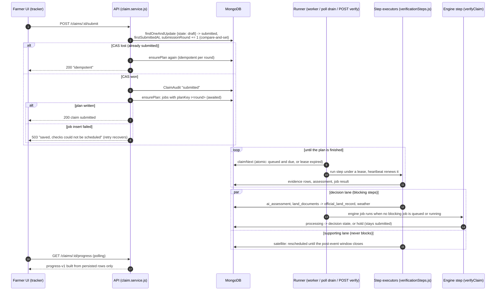
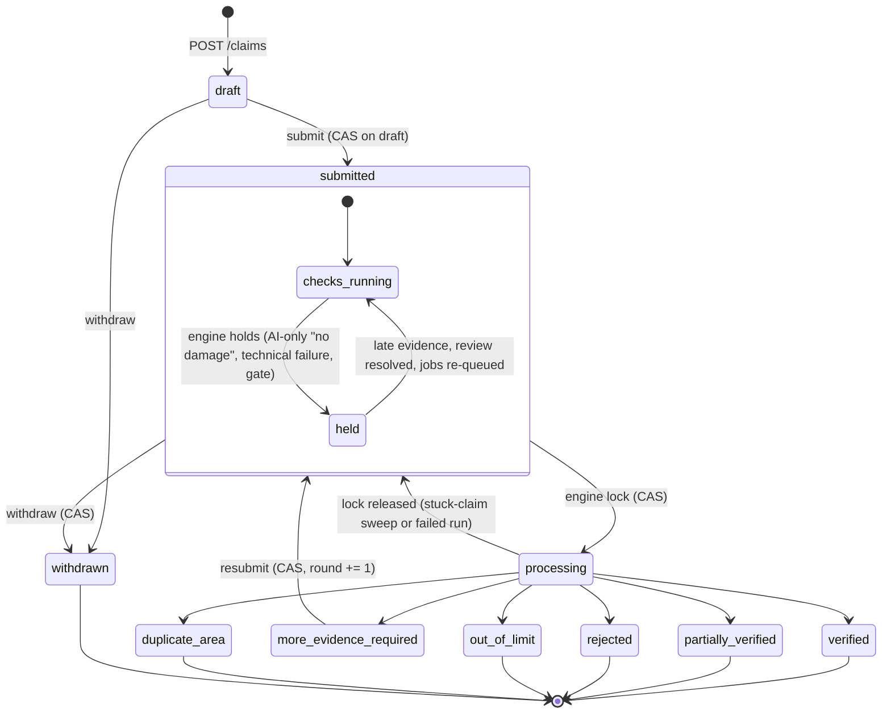

# Claim flow: submit, queue, worker, decision (ADR-022)

**Status (2026-10-17).** Implemented in the backend working tree on `develop` after `6dbe6b8`, **not committed and not deployed**. Covered by automated tests that run against an in-memory MongoDB with mocked providers. Not run against live providers as a flow, and not validated on real claims. The scheduled worker that runs this flow without a browser is **not deployed** (see [WORKER_RUNBOOK.md](../engineering/WORKER_RUNBOOK.md)).

| Level | Meaning in this document |
|---|---|
| Implemented | The code exists and is wired into the app. |
| Automated-test verified | Covered by passing tests with an in-memory database and mocked providers. |
| Live-provider verified | Exercised against the real provider. Nothing in this flow is at this level yet. |
| Real-world validated | Validated on real farmers, claims or documents. Nothing is at this level. |

Related: [JOB_ORCHESTRATION.md](../engineering/JOB_ORCHESTRATION.md) (queue details), [PROGRESS_CONTRACT_v1.md](PROGRESS_CONTRACT_v1.md) (what the farmer sees), [SATELLITE_LIMITATIONS.md](../engineering/SATELLITE_LIMITATIONS.md), ADR-021 and ADR-022 in [18_DECISIONS.md](../decisions/18_DECISIONS.md).

## 1. From submit to decision

A farmer submits once. The request writes the claim's verification plan as durable job rows before it answers. A runner then executes the jobs: the scheduled worker, a farmer's status poll, or a reviewer's `POST /verify`. The engine decides only after the steps it waits for have finished. Satellite runs in its own lane and is never waited for.

Code: `services/claim.service.js` (`submitForUser`, `resubmitForUser`, `withdrawForUser`), `services/claimVerificationPipeline.service.js` (`scheduleAutomatedVerification`, late-evidence plans), `services/verificationJobs.service.js` (`ensurePlan`, `claimNext`, `runJob`, `drain`), `services/verificationSteps.js` (executors), `services/verificationWorker.service.js` (sweeps, `runWorkerLoop`, Lambda handler).

### What the plan contains

`ensurePlan` (`services/verificationJobs.service.js:284`) queues only steps that have something to act on, then the engine:

| Condition on the claim | Steps queued |
|---|---|
| at least one stored photo | `ai_assessment` |
| at least one attached land document | `land_documents`, `official_land_record` |
| a claimed geometry | `satellite`, `weather` |
| always | `engine` |

The plan key is `r<submissionRound>`, so a repeated submit, a `POST /verify` or the reconcile sweep can call `ensurePlan` again and only creates steps that were never created. Late evidence after submit gets its own keys (`r<round>:ev:<photo-set version>` or `r<round>:doc:<evidenceId>`); see [JOB_ORCHESTRATION.md §3](../engineering/JOB_ORCHESTRATION.md#3-plans-and-idempotency).

### Who runs the jobs

| Runner | Trigger | Budget | Status |
|---|---|---|---|
| Scheduled Lambda `index.worker` | EventBridge rule in `infra/verification-worker.yaml` | invocation timeout minus 10 s, at most `WORKER_MAX_JOBS` (25) jobs | Implemented, automated-test verified, **not deployed** (rule DISABLED by default) |
| `npm run worker` | a developer or the e2e harness | `WORKER_BATCH_BUDGET_MS` (240 s) per batch | Implemented, automated-test verified (WK-1..8) |
| `GET /claims/:id/progress` and `GET /claims/:id/verification` | each owner poll, when `CLAIM_VERIFICATION_DRAIN_ON_READ=true` | one job, `CLAIM_VERIFICATION_READ_DRAIN_BUDGET_MS` (20 s) | Implemented, automated-test verified |
| `POST /claims/:id/verify` | reviewers and older clients; the farmer UI no longer calls it | `CLAIM_VERIFICATION_REQUEST_BUDGET_MS` (22 s) | Implemented, automated-test verified (VF-1..5) |

Without the scheduled worker, a claim moves only while someone polls it or calls `POST /verify`. See [KNOWN_ISSUES.md](../engineering/KNOWN_ISSUES.md) (K-01).

### What the engine waits for

The engine job waits while any job of a **blocking** step is queued or running (`blockingStepsFor`, `services/verificationJobs.service.js:415`). Satellite is never blocking under any policy (`NON_BLOCKING_STEPS`, line 70). Under all three policies the blocking set is `ai_assessment`, `land_documents`, `official_land_record` and `weather`. The engine is put back no earlier than 15 s later, or just after the earliest queued blocker's `runAt`.

Under `v1.1-safe-ai` (the default since 2026-10-16) the claim window is measured at `firstSubmittedAt`, so waiting for checks cannot turn into a late-claim rejection. Under `v1-legacy` and `v2-components` the window is still measured at decision time.

## 2. Claim states (frozen) and the "held" overlay

The ten claim states are frozen (ADR-019; `models/LossClaim.js:24`). No state was added. **"Held" is not a state**: a held claim stays `submitted`, its assessment has no decision (`assessment.state` is empty) and `assessment.verification.status` is `"held"` (`isHeldAssessment`, `services/adminOverrideRules.service.js`). The progress contract shows it as `waiting_for_review`, or `in_progress` while a failed check is still being retried.

Notes:
- The farmer transitions come from `services/claimState.service.js` (`ALLOWED`). `processing -> submitted` is written directly by `releaseProcessingSlot` (`services/claimVerification.service.js:375`) and recorded as a `verification_released` audit row.
- **Admin override** is the audited exception path outside this machine (`services/adminOverrideRules.service.js`). An admin may move a claim from `processing`, any decision state, or **`submitted` only when held** (owner decision D8) to a decision state. An override of a held claim cancels the claim's queued decision jobs (`ai_assessment`, `land_documents`, `official_land_record`, `engine`); satellite and weather keep running.
- `more_evidence_required` is a decision state (a farmer can resubmit from it); the other decision states and `withdrawn` are terminal.

## 3. Job states

Each job is one row in `verificationjobs` (`models/VerificationJob.js`). The enum also contains `failed`, which the current queue never writes.

```mermaid
stateDiagram-v2
    [*] --> queued: enqueue (ensurePlan, late evidence, re-evaluation, recovery)
    queued --> running: claimNext (due runAt; attempts += 1; lease = now + VERIFICATION_LEASE_MS)
    running --> running: heartbeat renews leaseUntil every lease/3
    running --> running: lease expired, another runner takes it over (attempts += 1)
    running --> queued: put back (not enough budget, or waiting for blockers; attempt refunded)
    running --> queued: rescheduled (step asked for rescheduleAt; attempt refunded, rescheduleCount += 1)
    running --> queued: retry scheduled (error, attempts below the limit, runAt = now + backoff)
    running --> queued: rerun (late evidence arrived while it ran; attempt refunded)
    running --> succeeded
    running --> dead: attempts exhausted (review case unless satellite or weather)
    running --> cancelled: claim withdrawn or missing
    queued --> cancelled: withdraw, or admin override of a held claim
    dead --> [*]: requeueDeadJobs creates a NEW queued job (recoveredFrom, recoveryRound + 1)
    succeeded --> [*]
    cancelled --> [*]
```

- **Lease owner check.** Every write a runner makes to a job it holds filters on `{_id, leaseOwner, status: "running"}` (`ownedFilter`, line 352). A runner whose lease was taken over gets `lease_lost` and changes nothing. A step that already called a provider may still have spent that call.
- **Uniqueness.** At most one active (queued or running) job per claim and step (`activeKey` unique partial index), and one job per claim, step and plan key (`{claimId, step, planKey}` unique partial index).
- **Withdrawn claims** never run another step: `runJob` cancels the job before it runs (`claim_withdrawn`), and a step that fails after a withdrawal is cancelled instead of opening a review case.

## 4. Where to read more

| Topic | Document |
|---|---|
| Steps, retries, error kinds, dead jobs, sweeps, log events | [JOB_ORCHESTRATION.md](../engineering/JOB_ORCHESTRATION.md) |
| Farmer progress contract, satellite truth table | [PROGRESS_CONTRACT_v1.md](PROGRESS_CONTRACT_v1.md) |
| Deploying and operating the worker | [WORKER_RUNBOOK.md](../engineering/WORKER_RUNBOOK.md) |
| Every environment variable | [ENVIRONMENT_VARIABLES.md](../engineering/ENVIRONMENT_VARIABLES.md) |
| Known gaps | [KNOWN_ISSUES.md](../engineering/KNOWN_ISSUES.md) |
