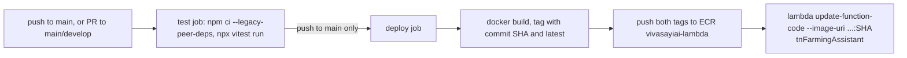
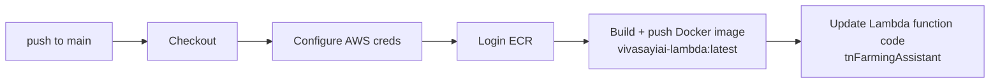
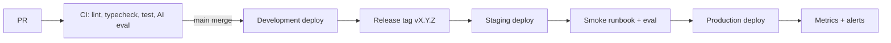

# 14 — Deployment

> **Metadata**
> - **Title:** 14 — Deployment
> - **Version:** 1.0
> - **Status:** `[ACTIVE]`
> - **Owner:** DevOps / Backend
> - **Last Reviewed:** 2026-10-17 (§0 added; §1-§7 are the August 2026 baseline, corrected where marked)
> - **Related Documents:** [06_System_Architecture](../architecture/06_System_Architecture.md) · [12_Technical_Guidelines](12_Technical_Guidelines.md) · [15_Security](15_Security.md) · [18_DECISIONS](../decisions/18_DECISIONS.md)

> **Why this document exists:** Anyone on the team must be able to run the stack locally and understand how code reaches production. This documents local setup, environments, environment variables, the current CI/CD, and the target flow.

---

## 0. Current state (2026-10-17)

**What is deployed:** only the API Lambda `tnFarmingAssistant`, from the last push to `main` (`origin/main` is `5efe561` at the time of writing; the live function itself was not inspected for this document). The October work on `origin/develop` (`b760596`, `6dbe6b8`) and the uncommitted 2026-10 completion work are **not deployed**. The verification worker is not deployed. The frontend has no hosting and no CI.

### 0.1 CI (`.github/workflows/deploy-lambda.yml`)



- The Lambda runs the **immutable commit-SHA tag**, so a rollback points the function at an earlier SHA.
- The Dockerfile uses `public.ecr.aws/lambda/nodejs:24`, `npm ci --omit=dev --legacy-peer-deps` and `CMD ["index.handler"]`. `.dockerignore` excludes `tests`, `docs`, `scripts/e2e`, `scripts/acceptance`, `scripts/live`, `scripts/eval`, `infra`, `test-results` and `.env*` (audit B).
- CI deploys only the API function. It does not deploy the worker stack, run migrations, run the frontend tests or run Playwright.

### 0.2 Production safety at boot (ADR-024)

`assertProductionSafety()` (`config/env.js`, called from `index.js` after `validateEnv` and from `scripts/worker.js`) refuses to start when `NODE_ENV=production` or `AWS_LAMBDA_FUNCTION_NAME` is set together with any dev or test seam: `IMAGE_STORAGE_MODE`, `IMAGE_AI_MODE`, `LAND_RECORD_MODE`, `WEATHER_MODE` or `SATELLITE_MODE` set to `mock`, `DEV_STORAGE_RECEIVER=true`, or `IMAGE_STORAGE_MOCK_DIR`. Audit B confirmed each refusal. **Check the production function's variables for these keys before deploying**: a function that has one set will no longer boot.

### 0.3 Releasing the 2026-10 verification work (owner decisions; none done)

1. Owner review; commit; merge to `main` (CI then deploys the API).
2. Run the migrations' dry runs against production, then apply them: `scripts/migrations/2026-10-verification-components.js` and `scripts/migrations/2026-10-verification-automation.js` (dry run by default; `--apply` against a remote database needs `MIGRATION_ALLOW_REMOTE_APPLY=true`). The automation migration's dry run against production is recorded in [MIGRATION_DRY_RUN_2026-10-16.md](MIGRATION_DRY_RUN_2026-10-16.md).
3. Deploy the worker with [WORKER_RUNBOOK.md](WORKER_RUNBOOK.md): preflight (including `CLAIM_AUTOMATED_VERIFICATION_ENABLED=true` and `CLAIM_VERIFICATION_DRAIN_ON_READ=true` on the API function, and no mock seams), deploy `infra/verification-worker.yaml` with the schedule DISABLED, copy the API's environment, smoke-test one invocation, then enable the schedule.
4. Configure a billed Gemini key (owner decision D6) before real claims; see [LIVE_PROVIDER_REQUIREMENTS.md](LIVE_PROVIDER_REQUIREMENTS.md).
5. Release the frontend tracker (which no longer calls `POST /verify`) **only together with the worker**. The frontend needs hosting first.

Every environment variable: [ENVIRONMENT_VARIABLES.md](ENVIRONMENT_VARIABLES.md).

## 1. Local development

### Prerequisites
- Node.js 20+ (backend Dockerfile uses Node 24 Lambda base; local Node 20+ is fine for dev)
- MongoDB: local instance **or** Atlas connection string
- API keys for Gemini, Cohere, ChromaDB Cloud (for chat); AWS keys + S3 bucket (for ingestion)

### Backend (`VivasayiAI`)
```bash
cd VivasayiAI
npm ci --legacy-peer-deps
# create .env (see §4) — copy values from your environment
npm run dev        # nodemon on http://localhost:8000
```
- Scripts: `start` (`node index.js`), `dev` (`nodemon index.js`), `test` (`vitest run`), `worker` (`node scripts/worker.js`), `e2e:backend`, `acceptance`, `acceptance:report` and others; see the README and [13_Testing_Strategy](13_Testing_Strategy.md) §0.
- The app connects to MongoDB at startup (`await connectDB()` in `index.js`) and initializes the ChromaDB collection + Gemini/Cohere clients at module load.

### Frontend (`VivasayiAI-Frontend`)
```bash
cd VivasayiAI-Frontend
npm install
# create .env (see §4)
npm run dev        # Vite on http://localhost:5173
npm run build      # production build
npm run typecheck  # tsc --noEmit
npm run lint       # eslint
```

### Run both
Backend on `:8000`, frontend on `:5173`; frontend `.env` `VITE_API_URL=http://localhost:8000`. Cognito redirect URI must include `http://localhost:5173`.

> **Corrected (2026-10-17):** weather now comes from the backend (`GET /weather`); the frontend no longer calls Open-Meteo. To see a claim decided locally without polling, also run `npm run worker` in the backend. Chat requires a fully configured backend (Gemini + Cohere + ChromaDB + Mongo).

---

## 2. Environments

| Environment | Backend | Frontend | Purpose |
|---|---|---|---|
| **Local** | localhost:8000 | localhost:5173 | development |
| **Development** | (planned) auto-deployed from `main` | (planned) preview build | integration |
| **Staging** | (planned) from release candidate | (planned) | QA + AI eval |
| **Production** | AWS Lambda `tnFarmingAssistant` | not yet deployed | live users |

> **Current reality:** only *local* and *production* (Lambda) exist. The CI deploys `main` directly to the Lambda. Staging and gated production deploys are Phase 1 infrastructure work.

---

## 3. Current CI/CD

### Backend — `.github/workflows/deploy-lambda.yml`
> **Superseded (2026-10-17):** the workflow now has a `test` job before the deploy and tags images with the commit SHA; see §0.1. The diagram below is the August 2026 workflow.

Trigger: push to `main`.



- Dockerfile: `public.ecr.aws/lambda/nodejs:24`, `npm ci --omit=dev --legacy-peer-deps`, `CMD ["index.handler"]`.
- Lambda entries (`index.js`): `handler` (the API) and `worker` (the scheduled verification worker, deployed separately from `infra/verification-worker.yaml`; not deployed).

### Frontend
- No CI/CD configured (no deploy target yet). Add Vercel/Netlify/CloudFront pipeline in Phase 1.

---

## 4. Environment variables

> **Superseded (2026-10-17):** the tables below are the August 2026 list. The complete, code-checked list is [ENVIRONMENT_VARIABLES.md](ENVIRONMENT_VARIABLES.md); both repositories now commit a `.env.example`.

### Backend `.env` (local; ignored by git — do not commit)
| Variable | Purpose | Required |
|---|---|---|
| `PORT` | local port (8000) | dev |
| `MONGO_URI` | MongoDB Atlas connection string | yes |
| `COGNITO_CLIENT_ID` | Cognito OAuth2 client | yes |
| `COGNITO_CLIENT_SECRET` | client secret (empty if none) | app-specific |
| `COGNITO_DOMAIN` | Cognito domain for token exchange | yes |
| `COGNITO_REDIRECT_URI` | must match frontend callback (e.g., `http://localhost:5173`) | yes |
| `GOOGLE_API_KEY` | Gemini API key (backend chat) | yes* |
| `MODEL_PROVIDER` | **Model Adapter provider: `gemini` today; future `llama`/`qwen`/`mistral`/`selfhosted` (F-45)** | yes |
| `MODEL_NAME` | model id for the active provider (e.g., `gemini-2.5-flash`) | yes |
| `MY_AWS_REGION` | S3 ingestion region | ingestion |
| `MY_AWS_ACCESS_KEY_ID` | S3 access | ingestion |
| `MY_AWS_SECRET_ACCESS_KEY` | S3 secret | ingestion |
| `S3_BUCKET` | dataset bucket | ingestion |
| `COHERE_API_KEY` | embeddings (chat + ingestion) | yes |
| `CHROMA_API_KEY` | ChromaDB cloud | yes |
| `CHROMA_TENANT` | ChromaDB tenant | yes |
| `CHROMA_DATABASE` | ChromaDB database | yes |

*Required by the `gemini` adapter; each adapter declares its own key (`LLAMA_API_KEY`, `OPENAI_BASE_URL`, etc.) and is validated by the config module (12_Technical_Guidelines §2b).

### Frontend `.env`
| Variable | Purpose |
|---|---|
| `VITE_API_URL` | backend base URL (`http://localhost:8000`) |
| `VITE_COGNITO_DOMAIN` | Cognito OAuth2 domain |
| `VITE_COGNITO_CLIENT_ID` | Cognito client |
| `VITE_COGNITO_REDIRECT_URI` | `http://localhost:5173` |

### Actions required (Phase 1)
1. Commit **`.env.example`** for both repos (with placeholder values, no secrets), including `MODEL_PROVIDER`/`MODEL_NAME`.
2. Move backend secrets to **AWS Secrets Manager / SSM Parameter Store**; Lambda reads at runtime. GitHub Actions uses repo secrets (already does for AWS). Per-provider keys live in the secret manager, referenced by the Model Adapter config.
3. Remove the need for ingestion keys at chat runtime (chat only needs Gemini/Cohere/Chroma/Mongo).
4. **Rotate all existing keys** — they exist in plaintext on developer machines (see 15_Security §4).

---

## 5. Target deployment flow (Phase 1)



### Backend target
- Build ECR image tagged with commit SHA + `latest`; Lambda versioned aliases (`dev`, `staging`, `prod`); `update-alias` instead of overwriting the live function.
- Provisioned concurrency or on-demand tuning after cold-start measurement.

### Frontend target
- Vercel/Netlify: preview per PR, `main` → dev, tag → staging, `main` stable → prod. Static asset CDN + caching.

---

## 6. Operational runbook (once live)

| Event | Action |
|---|---|
| Chat errors spike | Check Sentry + CloudWatch; verify Gemini/Chroma/Cohere status; check rate-limit + cost dashboard |
| Latency spike | Cold starts (provisioned concurrency), DB index usage, retrieval latency, LLM latency |
| Cost spike | Per-conversation dashboard; verify quotas/caching; throttle free tier |
| Model provider outage | Failover to fallback model or graceful degradation (chat-context-only mode exists) |
| Credential rotation | Rotate in secret manager, restart Lambda, update `.env.example`, log in DECISIONS |

## 7. Release checklist (before prod deploy)

- [ ] CI green (lint, typecheck, unit, integration).
- [ ] AI golden set ≥ threshold; no critical groundedness regressions.
- [ ] Smoke runbook passed on staging (see 13_Testing_Strategy §5).
- [ ] Security negatives passed (auth + cross-user isolation).
- [ ] Env vars/secrets in place for target environment.
- [ ] CHANGELOG updated (19).
- [ ] Rollback plan defined (previous image tag).
